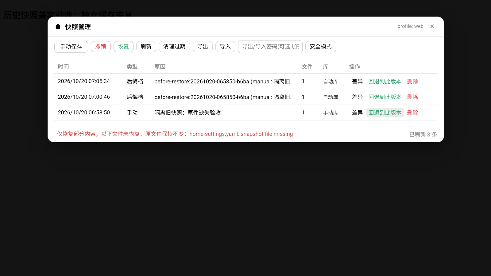
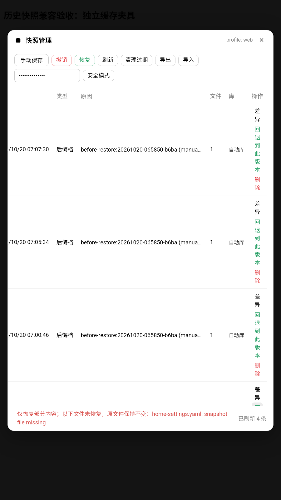

# 快照部分恢复的准确回执

关联 #428 第 11 项。主配置文件在快照缺失或名称不受当前版本支持时，原实现静默跳过。现在与插件、profile 分支一致记入 missing，保留当前文件不动。

页面将 missing 作为部分恢复警示显示，使用中英文文案，并取消这种结果的自动重载；避免 350ms 后提示消失。REST 仍保持原有 ok 与 missing 契约，工具端原有详细渲染继续可用。

验证：node --test scripts/source-build/undo-partial-restore.test.mjs，2 项通过。使用隔离 fixture 验证缺文件时旧配置字节不变，并执行真实 client.js 的回执与重载函数，验证部分恢复不会被报成全成功。未做设备验证，尚不能声明界面验收完成。

设备复核发现部分恢复的红色说明被通用状态标签省略，缺失文件名不可见。现只让快照管理器的错误说明换行并完整展示，提供 alert 语义和文本选择；普通成功短提示保持原样。实际生产组件在独立 Android 缓存服务中复验，不重新挂载已退役插件。

2026-10-20 设备证据：实际 client.js 的 SnapshotPanel 与实际 core 在独立缓存服务中运行。ADB 点击恢复并确认，CDP 核对完整缺失名、错误事件、页面未重载；当前配置字节未变。横屏与竖屏均通过。密码导出得到密文，重复导入只跳过已有快照。夹具提供归档路径选择，不声称验证了已退役的系统选文件入口。

